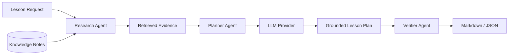

# EduMind: An LLM- and Knowledge-Augmented Agentic Lesson Preparation System


EduMind is a compact reference implementation of an agentic lesson-preparation pipeline. It combines structured lesson constraints, knowledge retrieval, provider-agnostic generation, provenance grounding, and output verification into one inspectable workflow.

## Overview

The system treats lesson preparation as a constrained planning problem rather than a single text-generation call. A lesson request is converted into a typed contract, relevant teaching notes are retrieved as evidence, an LLM provider generates a structured plan, and a verifier checks whether the result is usable and grounded.

The public implementation is intentionally small: every stage is executable locally, each boundary is replaceable, and the output is available as both Markdown and JSON.

## System Architecture



The provider boundary is compatible with an external vivo BlueLM integration while keeping credentials and transport details outside the repository. The included command uses the same typed contract and orchestration path for a reproducible local run.

## Core Pipeline

1. **Ingest** - parse Markdown teaching notes into stable `KnowledgeChunk` records.
2. **Retrieve** - rank evidence with deterministic term-frequency/IDF-style lexical scoring.
3. **Plan** - transform the request and evidence into objectives, a timed sequence, activities, and assessment.
4. **Ground** - preserve source IDs on the generated plan for traceability.
5. **Verify** - check objectives, sequence, activities, assessment, and evidence coverage.
6. **Render** - serialize the verified result to readable Markdown and machine-readable JSON.

## Quick Start

### Installation

```bash
git clone https://github.com/Jiangyou-rhyyy/EduMind-Agentic-Lesson-Preparation.git
cd EduMind-Agentic-Lesson-Preparation
python -m venv .venv
.\.venv\Scripts\activate       # Windows PowerShell
# source .venv/bin/activate        # macOS / Linux
python -m pip install -e ".[test]"
```

The runtime has no mandatory network service or model credential.

### Run the end-to-end demo

```bash
python -m edumind.demo \
  --topic "free fall" \
  --grade 10 \
  --duration 45 \
  --markdown-output outputs/free-fall.md \
  --json-output outputs/free-fall.json
```

Or run the library example:

```bash
python examples/lesson_preparation_demo.py
```

## Project Structure

```text
src/edumind/
├── schemas.py       # typed request, evidence, plan, and report contracts
├── knowledge.py     # Markdown ingestion and deterministic retrieval
├── providers.py     # provider protocol and local provider adapter
├── agents.py        # research, planning, and verification roles
├── pipeline.py      # end-to-end orchestration
├── render.py        # Markdown and JSON serialization
└── demo.py          # command-line entry point
data/knowledge/      # compact teaching-note fixtures
examples/            # library-level invocation
tests/               # unit, integration, and hygiene checks
scripts/             # repository safety checks
```

## Demo Output

For the bundled free-fall notes, the pipeline emits a lesson plan with:

- learning objectives connected to the requested topic;
- a 45-minute sequence with warm-up, evidence-grounded instruction, collaborative prediction, and an exit ticket;
- assessment prompts for explanation and transfer;
- source IDs showing which knowledge notes informed the plan;
- a verification report suitable for a downstream UI or API.

Example JSON shape:

```json
{
  "plan": {
    "request": { "topic": "free fall", "grade": "10", "duration_minutes": 45 },
    "objectives": ["Explain the core concepts of free fall."],
    "evidence": ["physics-free-fall"]
  },
  "verification": {
    "passed": true,
    "checks": ["objectives", "timing", "assessment", "evidence"]
  }
}
```

## Design Notes

- **Typed contracts over free-form strings.** The pipeline exchanges explicit records so providers, interfaces, and tests can evolve independently.
- **Evidence is a first-class output.** Retrieval results keep source IDs and normalized relevance scores instead of disappearing into a prompt.
- **Role separation.** Research, planning, and verification are independent components with narrow interfaces.
- **Deterministic local execution.** Retrieval, ordering, rendering, and verification are stable across runs, which makes the repository easy to test and review.
- **Provider isolation.** A production adapter can implement `LLMProvider` without changing the orchestration or renderer.

## Testing

```bash
python -m pytest -q
python scripts/check_repository.py
```

The test suite covers schema validation, ingestion, ranking, provider isolation, provenance, verification failures, output serialization, the CLI, and public-repository hygiene.

## Extension Points

- Replace lexical retrieval with a vector or hybrid retriever while preserving `KnowledgeStore.search`.
- Add multimodal evidence adapters for slides, images, or video transcripts behind the same evidence contract.
- Implement an external `LLMProvider` for vivo BlueLM or another provider without changing the agent graph.
- Add rubric-specific verifiers for different subjects, grade bands, or institutional lesson templates.
- Connect the JSON renderer to a web client, asynchronous job queue, or experiment tracker.

## Acknowledgements

The repository distills the system's knowledge-augmented retrieval, role-oriented orchestration, multimodal-resource direction, and teacher-facing planning workflow into a compact public reference implementation. The design is compatible with the broader retrieval-augmented generation literature and with provider integrations such as vivo BlueLM.

## License

Released under the Apache License 2.0. See [LICENSE](LICENSE).

